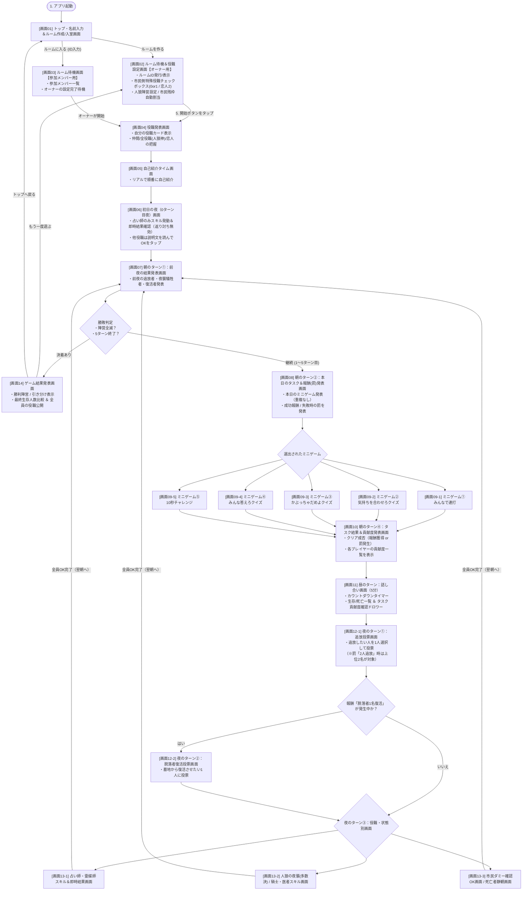
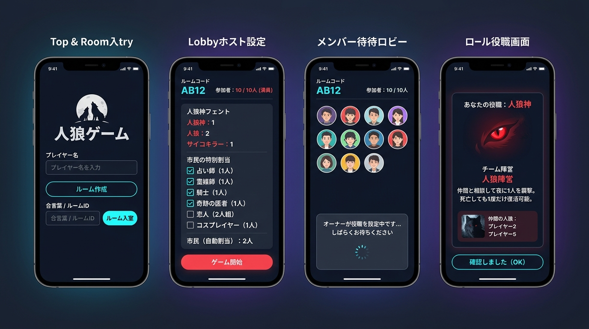
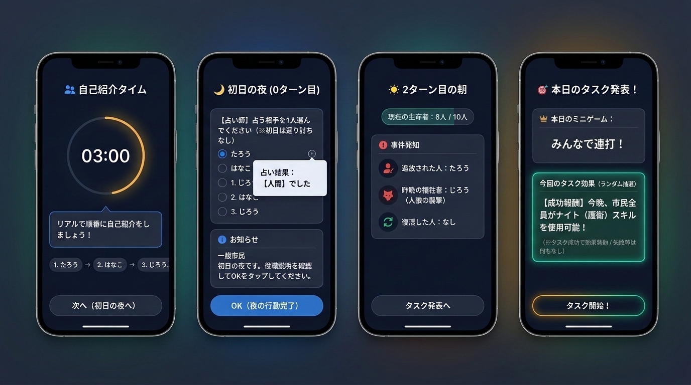
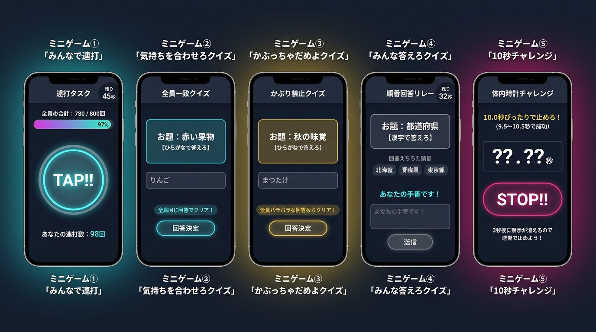
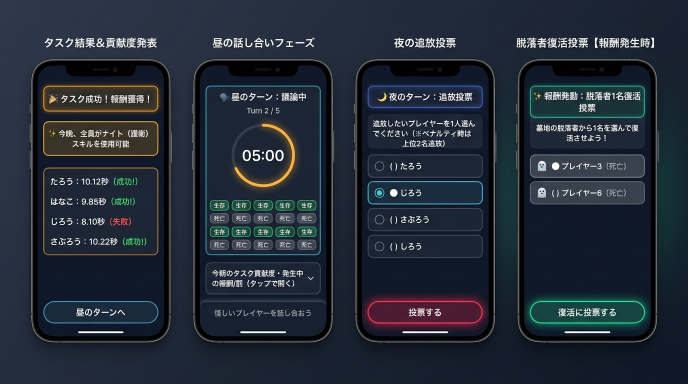
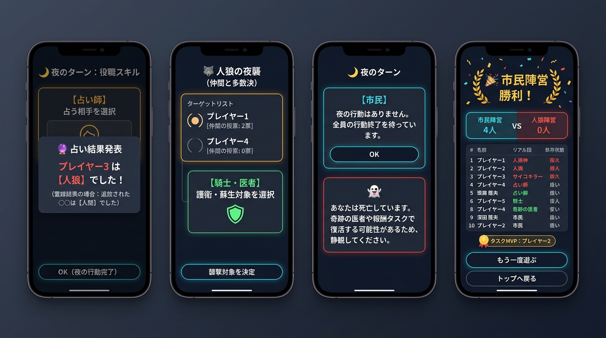

# オリジナル人狼ゲーム 画面遷移図・全画面イメージ設計書

## 1. 画面遷移図（全体フロー：全19画面）

ステップ1（アプリ起動）からステップ13（夜のターン）、ミニゲーム全5種、および勝敗決着までの全画面遷移図です。

---

## 2. 全画面イメージ図（全5シート・計19画面）

スマートフォン（縦画面・ダークテーマ基調）での全画面イメージ図です。

---

### シート①：準備・ロビー（オーナー／メンバー）・役職発表画面（画面01〜04）

| 画面番号・画面名 | 対応ステップ | 表示内容・操作仕様 |
| :--- | :---: | :--- |
| **[画面01] トップ・名前＆顔アイコン登録・ルーム作成/入室画面** | ステップ 1〜4 | ・**プレイヤー顔アイコン登録エリア（丸型プレビュー＋「📷 カメラを起動して顔を撮影」ボタン／写真選択）** ・プレイヤー名入力ボックス ・**最大ターン数指定（デフォルト：5ターン）**＋「ルームを作成する」ボタン（ルームオーナーになる） ・ルームID入力ボックス＋「入室する」ボタン（メンバーとして参加） |
| **[画面02] ルーム待機＆役職設定画面【オーナー用】** | ステップ 3・5 | ・発行されたルームIDと**指定ターン数（デフォルト5、ロビーでも変更可）**の表示 ・入室メンバー一覧（最大10人） ・**市民陣営の特殊役職チェックボックス（占い師・霊媒師・騎士・コスプレイヤー・奇跡の医者は各0または1人、恋人は0または2人組）** ・残り枠を「市民（自動割当）」として自動計算表示 ・人狼陣営の配分設定と「ゲーム開始」ボタン |
| **[画面03] ルーム待機画面【参加メンバー用】** | ステップ 4 | ・ルームIDと現在の入室メンバー一覧 ・「ルームオーナーが役職配分を設定中です…」の待機インジケーター |
| **[画面04] 役職発表画面** | ステップ 6 | ・**縦長（ポケモンカードサイズ比率 `63:88` / `5:7`）の役職カード**と能力説明を大きく表示 ・人狼神には全員の役職一覧、人狼には仲間の人狼、恋人には相方の名前を表示 ・「確認しました」ボタン |

---

### シート②：自己紹介・初日の夜・朝の結果＆タスク発表画面（画面05〜08）

| 画面番号・画面名 | 対応ステップ | 表示内容・操作仕様 |
| :--- | :---: | :--- |
| **[画面05] 自己紹介タイム画面** | ステップ 7 | ・リアルでの自己紹介を促す案内画面とタイマー ・全員の自己紹介が終わったら「初日の夜へ進む」をタップ |
| **[画面06] 初日の夜（0ターン目夜）画面** | ステップ 8 | ・**占い師のみ**：占う相手を1人選択し、その場で結果を確認してOKをタップ（※初日はサイコキラーの返り討ち無効） ・**その他の役職**：初日の夜の説明文を読んで「OK」をタップ（誰も襲撃されない） |
| **[画面07] 朝のターン①：前夜の追放・夜襲・復活発表画面** | ステップ 9前半 | ・前夜に投票で追放されたプレイヤーの発表 ・前夜に夜襲（またはサイコキラーの返り討ち等）で死亡した犠牲者の発表 ・奇跡の医者または報酬投票で復活したプレイヤーの発表 ・現在の生存者数カウント |
| **[画面08] 朝のターン②：本日のタスク＆報酬(または罰)発表画面** | ステップ 9後半 | ・ランダム（1ゲーム内重複なし）で選ばれた本日のミニゲーム名とルール説明 ・**メリット（成功報酬）とデメリット（失敗時の罰）の全ラインナップからランダムかつ重複なしで選ばれた「1つ」だけ**を提示 ・「タスク開始」ボタン |

---

### シート③：朝のタスク（ミニゲーム全5種）実行画面（画面09-1〜09-5）

| 画面番号・画面名 | 対応ステップ | 表示内容・操作仕様 |
| :--- | :---: | :--- |
| **[画面09-1] ミニゲーム①「みんなで連打」** | ステップ 10 | ・残り時間（60秒）タイマー ・チーム合計連打ゲージ（目標：生存メンバー数×100回） ・画面中央の巨大な「TAP!!」ボタンと自分の現在連打数 |
| **[画面09-2] ミニゲーム②「気持ちを合わせろクイズ」** | ステップ 10 | ・お題表示（例：「赤い果物【ひらがなで答えろ】」） ・回答テキスト入力欄と「回答決定」ボタン（全員一致でクリア） |
| **[画面09-3] ミニゲーム③「かぶっちゃだめよクイズ」** | ステップ 10 | ・お題表示（例：「秋の味覚【ひらがなで答えろ】」） ・回答テキスト入力欄と「回答決定」ボタン（1人も重複しなければクリア） |
| **[画面09-4] ミニゲーム④「みんな答えろクイズ」** | ステップ 10 | ・お題表示（例：「都道府県【漢字で答えろ】」）と残り時間（60秒） ・すでに回答された履歴リストと回答順インジケーター ・自分の手番で有効になるテキスト入力欄と「送信」ボタン |
| **[画面09-5] ミニゲーム⑤「10秒チャレンジ」** | ステップ 10 | ・「10.0秒ぴったりで止めろ！（9.5〜10.5秒で成功）」の案内 ・スタート後途中から「??.??秒」に隠れるデジタルタイマーと「STOP!」ボタン |

---

### シート④：タスク結果＆貢献度・昼の議論・夜の追放＆復活投票画面（画面10〜12-2）

| 画面番号・画面名 | 対応ステップ | 表示内容・操作仕様 |
| :--- | :---: | :--- |
| **[画面10] 朝のターン④：タスク結果＆貢献度発表画面** | ステップ 11 | ・タスクの成功／失敗バナーと、発動した報酬または罰の通知 ・**全プレイヤーの貢献度一覧**（連打回数、入力した回答、ストップ秒数など）を公開し、人狼のサボり・妨害を推理する材料にする |
| **[画面11] 昼のターン：話し合い画面** | ステップ 12 | ・5分間のカウントダウンタイマーと現在ターン表示（1/5〜5/5） ・全プレイヤーの生存／脱落ステータス一覧 ・下部ドロワー：今朝のタスク貢献度や現在有効な報酬／罰をいつでも確認可能 |
| **[画面12-1] 夜のターン①：追放投票画面** | ステップ 13-1 | ・生存者リストから追放したい1人を選択して「投票する」をタップ ・※タスク罰「2人追放」発生時は上位2名が追放される旨を表示（同票時はランダム） |
| **[画面12-2] 夜のターン②：脱落者復活投票画面【報酬時】** | ステップ 13-2 | ・朝のタスク報酬で「脱落者1名復活」を獲得したターンのみ表示 ・脱落者（追放者・夜襲犠牲者全員）リストから復活させたい1人に投票 |

---

### シート⑤：夜のスキル発動（役職別・即時結果）・静観・最終結果発表画面（画面13-1〜14）

| 画面番号・画面名 | 対応ステップ | 表示内容・操作仕様 |
| :--- | :---: | :--- |
| **[画面13-1] 夜のターン③：占い師・霊媒師スキル＆即時結果画面** | ステップ 13-3 | ・**占い師**：占う相手を選択した直後、その場で「〇〇さんは【人間 / 人狼】でした」とポップアップ表示 ・**霊媒師**：スキル発動直後、ステップ13-1で確定した追放者についてその場で「追放された〇〇さんは【人間 / 人狼】でした」と表示 ・確認して「OK」をタップ（朝にスマホを注視しなくて済むため役職バレしない） |
| **[画面13-2] 夜のターン③：人狼の夜襲 ＆ 騎士・医者スキル画面** | ステップ 13-3 | ・**人狼・人狼神**：夜襲する対象を選択（仲間の人狼が誰を選んでいるかも表示し、多数決・同票ランダムで決定） ・**騎士・コスプレイヤー**：護衛する対象を1人選択してOK ・**奇跡の医者**：ゲーム中1回のみ、死亡者リストから蘇生する1人を選択してOK |
| **[画面13-3] 夜のターン③：市民ダミー確認画面 ＆ 死亡者静観画面** | ステップ 13-3 | ・**上段（市民・狂人・サイコキラー・恋人）**：説明文を読んで他の能力者と同じ位置の「OK」をタップ（※報酬で全員ナイト／占い付与時は対象選択画面に切り替わる） ・**下段（死亡者・静観画面）**：「あなたは死亡しています。復活の可能性があるため静観してください」の待機画面 |
| **[画面14] ゲーム結果発表画面** | 決着時 | ・勝敗結果（「市民陣営 勝利！」「人狼陣営 勝利！」「引き分け」）の大きな演出 ・最終生存人数の比較（市民陣営 vs 人狼陣営） ・全10プレイヤーの役職・陣営・最終ステータスの完全公開一覧 ・「もう一度遊ぶ」「トップへ戻る」ボタン |
