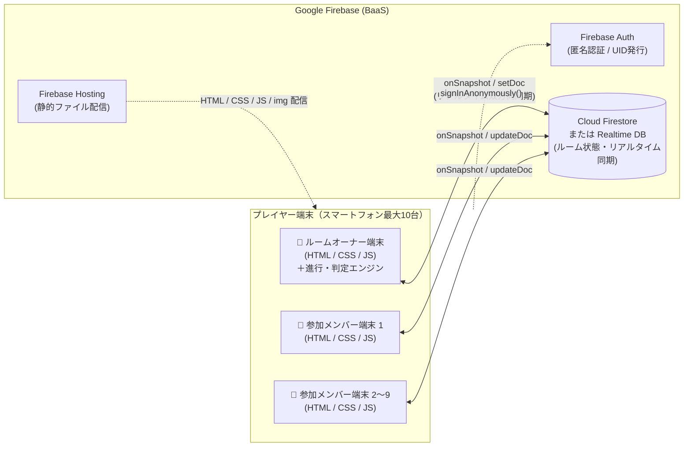
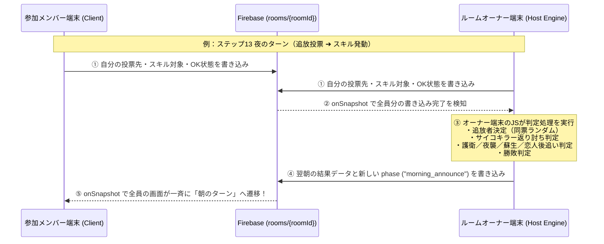
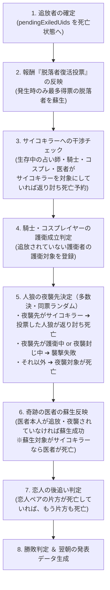

# オリジナル人狼ゲーム システム構成・アーキテクチャ設計書

## 1. システム構成概要（Tech Stack）

本システムは、ビルド環境や複雑なフレームワークを必要とせず、標準の **HTML / CSS / JavaScript（ES Modules）** と **Google Firebase** のみでリアルタイム通信対戦を実現するサーバーレスWebアプリケーション構成とします。



### 採用技術スタック
| レイヤー | 技術要素 | 採用理由・役割 |
| :--- | :--- | :--- |
| **画面構造・見た目** | **HTML5 / CSS3** | レスポンシブ対応、ネイティブ `<dialog>`・`<details>` 活用、CSS変数による朝・昼・夜のテーマ切替。 |
| **アプリケーションロジック** | **Vanilla JavaScript (ES Modules)** | `<script type="module">` により、バンドラーなしで機能別にJSファイルを分割管理。 |
| **画像アセット管理** | **`img/` フォルダ分離構成** | 役職カード（縦長 5:7）・背景・アイコンを独立ファイル化し、デザイナーが同名ファイルを上書きするだけで差し替え可能。 |
| **ユーザー識別** | **Firebase Authentication（匿名認証）** | ログイン不要で端末ごとに固有の `uid` を自動発行。画面リロードや一時切断後の再入室でも同一プレイヤーとして復帰可能。 |
| **リアルタイム通信・DB** | **Cloud Firestore**（または Realtime Database） | ルームIDをキーとして、最大10人の入室状態・フェーズ遷移・投票・ミニゲーム進捗をリアルタイムリスナー（`onSnapshot`）で同期。 |

---

## 2. アーキテクチャ方式：ホスト（ルームオーナー）権威型ステートマシン

Cloud Functions 等の有料サーバーサイド処理を使わず、**HTML + JS + Firebase DB だけ**で矛盾なくゲームを進行するため、**「ルームオーナー端末がゲームマスター（判定エンジン）を兼ねる方式（Host-Authoritative Architecture）」**を採用します。



### この方式のメリット
1. **競合（Race Condition）の防止**：複数人が同時に「次のフェーズへ進める処理」や「ランダム抽選」を実行してしまうバグが起きず、常にオーナー端末1台だけが抽選（役職配分・タスク抽選・同票ランダム決定）と勝敗判定を行います。
2. **完全無料枠（Sparkプラン）での運用が可能**：バックエンドサーバーを維持する必要がなく、クライアントJSとFirestore（またはRealtime DB）の読み書きのみで完結します。

---

## 3. ルーム接続・認証・再接続の実現方法

### ① アプリ起動時の匿名認証
* ページ読み込み時に Firebase Auth の `signInAnonymously(auth)` を実行し、端末固有の `uid` を取得します。
* 取得した `uid` がプレイヤーの内部IDとなります（同じ名前「たろう」が2人いても `uid` で正確に区別できます）。

### ② ルームIDの発行 ＆ ターン数指定（ステップ3：ルームオーナー）
* オーナーが**最大ターン数（デフォルト：`5` ターン）**を指定して「ルーム作成」を押すと、読み間違いしにくい英数字4文字（`O, 0, I, 1` を除いた `ABCDEFGHJKLMNPQRSTUVWXYZ23456789`）からランダムな4桁（例：`AB12`）を生成します。
* `rooms/AB12` が未使用であることを確認し、`maxTurns: 5` を含むルームドキュメントを作成してロビー画面へ遷移します（ロビー画面でも開始前までターン数を変更可能）。

### ③ ルームID指定での接続（ステップ4：参加メンバー）
* メンバーがルームID（例：`AB12`）を入力して「入室」を押すと、`rooms/AB12` の存在と `status === "waiting"`（開始前）および参加人数（10人未満）をチェックします。
* `rooms/AB12/players/{uid}` に自分の名前・撮影した顔アイコン（`avatarDataUrl`）を登録し、`onSnapshot(doc(db, "rooms", roomId))` でルームの状態監視を開始します。

### ④ 顔アイコン（スマホカメラ自撮り）の撮影・軽量化・同期方法
トップ画面（ステップ2）でスマホのカメラを起動して自分の顔をアイコン登録する機能は、**外部ストレージ（Firebase Storage）を使わず、Firestore（またはRealtime DB）だけで高速に全端末へ共有できる仕組み**で実装します：

1. **カメラ起動（2方式のハイブリッド対応）**
   * **方式A（アプリ内ライブカメラ撮影）**：`navigator.mediaDevices.getUserMedia({ video: { facingMode: "user", width: 256, height: 256 } })` でインカメラ映像を丸型 `<video muted playsinline>` に映し、「📸 撮影する」ボタンでその場撮影。
   * **方式B（OS標準カメラ起動／写真選択フォールバック）**：`<input type="file" accept="image/*" capture="user">` を併用し、カメラ権限がブロックされている環境や標準カメラアプリで撮りたい場合にも100%動作するようにします（未撮影時は `img/avatar_01.svg`〜`avatar_10.svg` のデフォルトアイコンを使用）。
2. **Canvas による正方形クロップ ＆ 超軽量圧縮（約 4〜8 KB）**
   * スマホカメラの元画像（数MB）をそのまま送信すると通信が重くなるため、撮影直後にブラウザ内の `<canvas width="144" height="144">` で中央を正方形に切り抜き、`canvas.toDataURL("image/webp", 0.75)`（非対応ブラウザは `image/jpeg`）で圧縮します。
   * これによりデータサイズが **1人あたり約 5KB 程度の短い文字列（Data URL）** になり、`rooms/{roomId}/players/{uid}` の `avatarDataUrl` フィールドに直接保存して全プレイヤーの画面（ロビー・投票・昼の生存一覧）へ瞬時に同期できます。

---

## 4. データベース設計（Firestore データ構造）

```text
rooms (コレクション)
 └── {roomId} (ドキュメント: 例 "AB12")
      ├── roomId: "AB12"
      ├── hostUid: "uid_player1"
      ├── status: "waiting" | "playing" | "finished"
      ├── turn: 1                      // 現在のターン数: 0(初日夜) 〜 maxTurns
      ├── maxTurns: 5                  // ルーム作成時に指定した最大ターン数（デフォルト5）
      ├── phase: "morning_task_play"   // 現在の画面フェーズID (s02〜s14に対応)
      ├── phaseEndsAt: 1794455000000   // タイマー終了時刻 (Unixミリ秒)
      │
      ├── roleConfig: {                // オーナーが設定した役職配分
      │     wolf_god: 1, werewolf: 1, madman: 0, psycho: 1,
      │     seer: true, medium: true, knight: true,
      │     lovers: true, cosplayer: false, doctor: true
      │   }
      │
      ├── usedTasks: ["mash"]          // 1ゲーム内で使用済みのミニゲームID（重複防止）
      ├── usedEffects: ["all_knight"]  // 1ゲーム内で使用済みの報酬・罰ID（重複防止）
      ├── currentTask: { id: "mash", title: "みんなで連打", target: 800 }
      ├── currentEffect: { id: "all_knight", type: "reward" }
      ├── activeEffectFlags: {         // 今ターン有効な報酬・罰フラグ
      │     allKnight: true, allSeer: false, reviveVote: false,
      │     noAttack: false, extraAttack: false, seerDisabled: false, doubleExile: false
      │   }
      │
      ├── morningReport: {             // ステップ9 冒頭で発表する前夜の結果
      │     exiledNames: ["ろくろう"],
      │     victimNames: ["はちろう"],
      │     revivedNames: []
      │   }
      │
      ├── players (サブコレクション: 公開プレイヤー状態)
      │    └── {uid}
      │         ├── name: "たろう"
      │         ├── avatarId: 1
      │         ├── avatarDataUrl: "data:image/webp;base64,..." // スマホカメラで撮影した顔アイコン(144x144圧縮)
      │         ├── isAlive: true
      │         ├── isReady: false      // 各フェーズの「OK」「投票完了」フラグ
      │         └── taskContribution: 98 // 朝のミニゲームのスコア・回答・秒数
      │
      ├── secrets (サブコレクション: 役職・秘匿データ)
      │    └── {uid}
      │         ├── role: "wolf_god"
      │         ├── team: "wolf"        // "wolf" | "citizen"
      │         ├── doctorUsed: false   // 奇跡の医者のスキル使用済みフラグ
      │         └── viewData: { ... }   // 人狼神の全役職一覧、人狼の仲間、恋人の相方
      │
      └── nightActions (サブコレクション: 各ターンの投票・夜スキル入力)
           └── {uid}
                ├── exileVoteUid: "uid_player3"
                ├── reviveVoteUid: null
                ├── skillType: "seer" | "guard" | "revive" | "wolf_attack" | "none"
                └── skillTargetUid: "uid_player2"
```

---

## 5. コア機能の実現ロジック詳細

### ① 役職の「即時結果表示」と「追放・夜襲によるスキル無効」の両立
本ゲームでは「スマホを見る動作で役職がバレないように、占い師・霊媒師は夜のスキル発動ターンで即座に結果を確認できる」かつ「追放・夜襲された人のスキルは無効」という仕様を持ちます。これは以下の2段階処理で実現します：

1. **ステップ13-1（追放投票完了時）**：
   * 全員が追放投票を終えた時点で、オーナー端末が集計を行い、内部フィールド `pendingExiledUids`（通常1名、罰「2人追放」時は2名）を確定させます（※画面上ではまだ発表しません）。
2. **ステップ13-3（スキル発動・即時表示）**：
   * **占い師**：対象プレイヤーを選択した瞬間、対象の `role` を参照して「人間」または「人狼」（※`role === "cosplayer"` の場合は「人狼」と表示！）をネイティブ `<dialog>` モーダルで即座に表示します。
   * **霊媒師**：スキルボタンを押した瞬間、ステップ13-1で内部確定した `pendingExiledUids` の `role` を参照し、「人間」または「人狼」（※コスプレイヤーは霊媒では「人間」）を即座に表示します。
   * もし占い師や霊媒師自身がその夜に追放・夜襲されていた場合でも、翌朝（ステップ9）の冒頭で死亡が発表されて議論から脱落するため、夜の時点で画面に結果が表示されてもゲーム進行上の矛盾は一切生じません。
   * **騎士・コスプレイヤー・奇跡の医者**については、ステップ13-3終了時の夜間一括判定（後述）において、本人が追放された場合（および奇跡の医者が夜襲された場合）はスキル効果を無効化します。

---

### ② 夜間一括判定アルゴリズム（サイコキラー・護衛・蘇生・恋人後追い）
全員がステップ13-3の「OK」をタップした時点で、オーナー端末が以下の順序で夜間判定を実行します：



---

### ③ ミニゲーム全5種の同期と通信最適化
朝のターンでは、既に選ばれたミニゲーム（`usedTasks`）と効果（`usedEffects`）を除外した候補からランダムで1つずつ抽選します。

| ミニゲーム | リアルタイム同期・実装方法 |
| :--- | :--- |
| **① みんなで連打** | **【スロットリング同期】** 1タップごとにDB通信すると最大1,000回の書き込みが発生するため、画面の自分のカウントはローカルで即時 `+1` し、**1秒に1回の間隔（および終了時）にまとめて Firestore の自分の連打数を更新**します。これにより遅延ゼロの爽快な連打と通信量削減を両立します。 |
| **② 気持ちを合わせろ** | 各自が回答テキストを入力して送信。全員送信（または時間切れ）後、オーナー端末が全員の回答文字列を正規化（前後空白除去）し、**全員完全一致しているか**を判定します。 |
| **③ かぶっちゃだめよ** | 全員の回答を集計し、`new Set(answers).size === alivePlayers.length`（**重複が1つもないか**）で成功判定します。 |
| **④ みんな答えろ** | 生存者の回答順配列 `turnOrder` を作成し、現在の手番プレイヤーの入力欄のみを有効化します。送信された回答が既出リストに含まれておらず、かつお題の辞書データ（例：47都道府県リスト）に含まれていれば次の人へ手番を回し、1分以内に全員クリアで成功とします。 |
| **⑤ 10秒チャレンジ** | 各自のスマホで `performance.now()` による高精度タイマーを開始し、3.00秒経過時点で表示を `??.??` にマスクします。STOP押下時の秒数を記録し、生存者全員（または規定人数）が `9.50 <= sec <= 10.50` に収まっていれば成功とします。 |

---

### ④ タイマーの端末間ズレ防止（時刻ベース同期）
スマートフォンのブラウザでは、画面スリープや別タブ切り替えで `setInterval` が遅延することがあります。そのため、「残り秒数をカウントダウンして通信する」のではなく、**「フェーズ終了予定時刻（`phaseEndsAt = Date.now() + 300_000`）」をDBに1回だけ書き込み、各端末で `phaseEndsAt - Date.now()` から残り時間を計算して円形タイマーを描画**します。これにより全プレイヤーのタイマーが常に0.1秒単位で一致します。

---

## 6. アプリケーションのディレクトリ・ファイル構成案

デザイナーが作成した `img/` をそのまま活かせる、シンプルで見通しの良いファイル構成です。

```text
jinrou/
 ├── doc/                       # 設計ドキュメント一式
 │    ├── game_spec.md          # ゲームルール・役職・ミニゲーム仕様書
 │    ├── screen_design.md      # 画面遷移図・全画面イメージ設計書
 │    └── system_architecture.md# 本ドキュメント（システム構成・アーキテクチャ）
 │
 ├── mockup2/                   # 画面遷移モックアップ（デザイン準拠版）
 │    ├── index.html
 │    ├── styles.css
 │    ├── app.js
 │    └── img/                  # デザイナー差し替え用画像フォルダ（全50ファイル）
 │
 └── src/ (または公開ルート)     # 本実装時のアプリケーション構成案
      ├── index.html            # エントリーHTML（全14画面セクション＋モーダル）
      ├── styles.css            # スタイルシート
      ├── img/                  # 差し替え用画像フォルダ（mockup2/img と同一構成）
      └── js/
           ├── main.js          # アプリ初期化・画面遷移コントローラー
           ├── firebase.js      # Firebase SDK初期化・Auth・Firestoreラッパー
           ├── room.js          # ルーム作成・入室・ロビー役職設定ロジック
           ├── hostEngine.js    # オーナー端末用：役職配布・夜間判定・勝敗判定エンジン
           ├── nightSkills.js   # 投票・占い/霊媒即時結果モーダル・スキルUI制御
           └── minigames/       # 拡張可能なミニゲームモジュール群
                ├── index.js    # ミニゲーム登録・抽選レジストリ
                ├── mash.js     # ① みんなで連打
                ├── matchQuiz.js# ② 気持ちを合わせろクイズ
                ├── uniqueQuiz.js# ③ かぶっちゃだめよクイズ
                ├── relayQuiz.js# ④ みんな答えろクイズ
                └── timer10.js  # ⑤ 10秒チャレンジ
```
